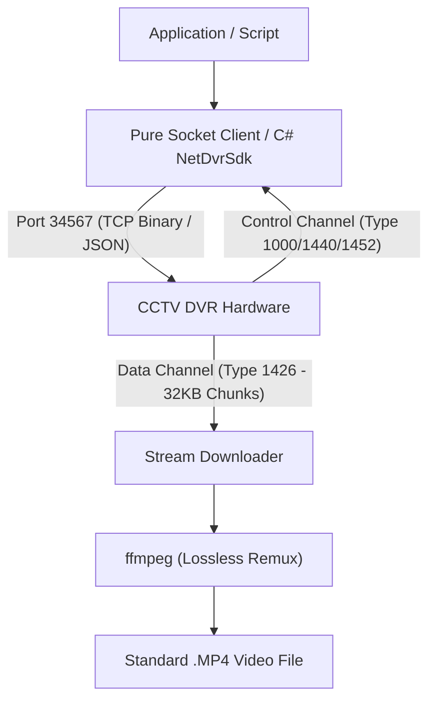

# OpenXM-DVR

> **Open-Source Client Libraries, Wire Protocol Specifications, and Tooling for Xiongmai (XM) / Sofia / NetSDK / H.264 DVRs & NVRs (Port 34567)**

[](https://opensource.org/licenses/MIT)
[]()
[]()

---

## 📌 Overview

Millions of standalone CCTV DVR systems worldwide communicate over **TCP port 34567** using the proprietary NetSDK / Sofia binary protocol.

Following the deprecation of Internet Explorer and ActiveX controls (`WebCtrl.ocx`), accessing, managing, and backing up footage from these devices without proprietary vendor software has become a major challenge for developers and system integrators.

**OpenXM-DVR** provides a reverse-engineered specification and implementation for interacting directly with these recorders:

1. **Clean-Room Wire Protocol (`docs/WIRE_PROTOCOL.md`):** Complete specification of the TCP packet protocol, authentication handshake, search offsets, and dual-socket media streaming.
2. **Pure Python Client (`python/pure_dvr_client.py`):** Zero-dependency, cross-platform client that runs natively on Linux, macOS, Android (via Termux/Kivy), Windows, and Raspberry Pi without native vendor DLLs.
3. **C# / .NET SDK (`src/NetDvrSdk/`):** High-performance .NET class library with P/Invoke interop, async downloads, and automated MP4 remuxing.
4. **Device Management & Configuration (`docs/CONFIGURATION.md`):** Protocols for RTC clock synchronization, camera OSD channel naming, video bitrate/resolution adjustments, storage formatting, and virtual front-panel control.
5. **Turnkey Backup Utility (`tools/DvrBackup/`):** Automated incremental archiver capable of multi-day continuous historical backups with ffmpeg remuxing.

---

## ✨ Capabilities

- **Direct Hard Disk Download (No RTSP Overhead):** Retrieves recorded segments directly from internal DVR HDD sectors (`/idea0/`) at maximum network bandwidth (1.5 – 3.0+ MB/s).
- **Instant Lossless MP4 Remuxing:** Packages raw H.264 elementary streams into playable MP4 containers in milliseconds without re-encoding.
- **Full Configuration & System Control:**
  - Query and set real-time hardware clock (RTC).
  - Rename on-screen camera channel titles (OSD).
  - Inspect hard drive capacity, partition tables, and remaining space.
  - Configure recording schedules, video resolution (1080N/720P/D1), and bitrate.
  - Remote system reboot and maintenance.
- **Smart Incremental Backup:** Automatically skips existing verified video files.
- **Reliable Long-Stream Archiving:** Built-in background KeepAlive watchdog prevents the ~47 MB DVR inactivity timeout, enabling multi-gigabyte continuous downloads without stream truncation.
- **Hardware Playback Slot Protection:** Mutex-synchronized streaming prevents hardware lockouts on single-playback embedded DVR SoCs.
- **Zero-Dependency Mode:** Connect, authenticate, query, and download using standard TCP sockets without external binaries.

---

## 🏗️ Architecture



---

## 🚀 Quick Start (Python - Zero Dependencies)

The pure Python client runs anywhere with Python 3.6+ and requires no third-party packages:

```python
from python.pure_dvr_client import PureDvrClient

# 1. Connect and Authenticate
client = PureDvrClient("192.168.1.100", 34567)
if client.connect("admin", "password"):
    print("Connected! Session:", hex(client.session_id))

    # 2. Query System RTC Time
    rtc = client.get_time()
    print("DVR Clock:", rtc.get("formatted"))

    # 3. Synchronize Time
    # client.set_time("2026-10-13 18:30:00")

    # 4. Search Channel 1 Recordings for a Specific Date
    files = client.search_files(channel=0, year=2026, month=10, day=13)
    print(f"Found {len(files)} recording segments on Channel 1.")

    # 5. Download Recording Directly from Hard Drive (Auto-Keepalive enabled)
    if files:
        target = files[0]
        print(f"Downloading: {target.remote_path} ({target.size_mb:.1f} MB)...")
        client.download_file(
            target,
            "channel1_segment.h264",
            progress_callback=lambda pct, b, spd: print(f"\rProgress: {pct}% | Speed: {spd:.2f} MB/s", end="")
        )
        
        # 6. Lossless Remux to Standard MP4
        from python.pure_dvr_client import convert_to_mp4
        convert_to_mp4("channel1_segment.h264", "channel1_segment.mp4")
        print("\nDownloaded and remuxed successfully!")
        
    client.close()
```

---

## 💻 Quick Start (C# / .NET)

```csharp
using System;
using NetDvrSdk;

class Program
{
    static void Main()
    {
        using (var client = new DvrClient())
        {
            if (client.Connect("192.168.1.100", 34567, "admin", "password"))
            {
                // Query recordings on Channel 1
                var files = client.QueryFiles(channelIndex: 0, DateTime.Today);

                foreach (var file in files)
                {
                    string rawPath = file.GenerateCleanFileName(".h264");
                    string mp4Path = file.GenerateCleanFileName(".mp4");

                    bool ok = client.DownloadFile(file, rawPath, prog => {
                        Console.Write($"\rDownloading: {prog.Percentage}% ({prog.SpeedMBs:F2} MB/s)");
                    });

                    if (ok)
                    {
                        DvrClient.ConvertToMp4(rawPath, mp4Path);
                        System.IO.File.Delete(rawPath);
                        Console.WriteLine($"\nSaved: {mp4Path}");
                    }
                }
            }
        }
    }
}
```

---

## 🛠️ CLI Archiver (`DvrBackup`)

The precompiled backup tool supports single-command backups and cron automation:

```powershell
# List recording catalog for the past 7 days:
.\DvrBackup.exe --mode list --channel 1 --days 7

# Download all recordings after 13:00 today:
.\DvrBackup.exe --mode download --channel 1 --date 2026-10-13 --after 13:00

# Automated continuous 100-day incremental backup:
.\DvrBackup.exe --mode download --channel 1 --days 100 --out "D:\CCTV_Backup"
```

---

## 📖 Technical Documentation

- [**docs/WIRE_PROTOCOL.md**](docs/WIRE_PROTOCOL.md): Packet structures, Sofia hash algorithm, search offsets, and dual-socket transport.
- [**docs/CONFIGURATION.md**](docs/CONFIGURATION.md): Complete guide to system time, channel titles, video encoding, storage, and remote keys.
- [**docs/PROTOCOL.md**](docs/PROTOCOL.md): Native P/Invoke structure layouts and memory alignment rules.
- [**docs/EXPORTS.md**](docs/EXPORTS.md): Complete catalog of all 71 exported SDK functions categorized.

---

## 📁 Repository Structure

```text
OpenXM-DVR/
├── docs/                      # Technical specifications & protocols
│   ├── WIRE_PROTOCOL.md       # Clean-Room TCP wire protocol specification
│   ├── CONFIGURATION.md       # Full device settings and hardware management guide
│   ├── PROTOCOL.md            # P/Invoke struct alignments and binary offsets
│   └── EXPORTS.md             # All 71 exported SDK functions indexed
├── python/                    # Cross-platform zero-dependency client
│   └── pure_dvr_client.py     # Pure Python socket client (Linux, Android, macOS, Win)
├── src/
│   └── NetDvrSdk/             # C# .NET class library
│       ├── DvrClient.cs       # High-level client API
│       ├── DvrModels.cs       # Domain models
│       ├── NativeMethods.cs   # P/Invoke declarations
│       └── NetDvrSdk.csproj   # Project file
├── tools/
│   └── DvrBackup/             # Automated CLI archiver & batch menu
│       ├── Program.cs         # CLI archiver source code
│       └── dvr_backup.bat     # Interactive menu
├── native/
│   └── x86/                   # Native NetSDK dependency binaries
├── .gitignore
├── LICENSE                    # MIT License
└── README.md
```

---

## 📄 License

This project is licensed under the [MIT License](LICENSE).
