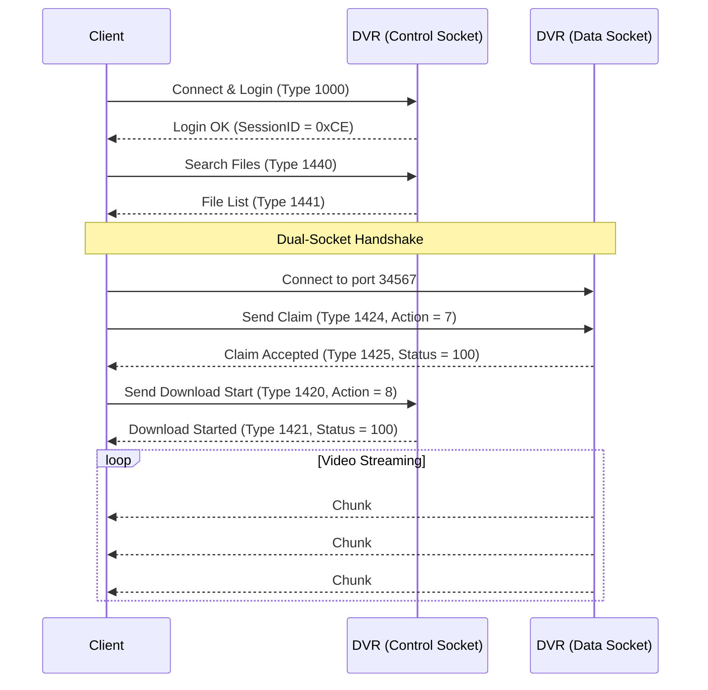

# Port 34567 Binary Wire Protocol Specification (Clean Room)

This document specifies the exact TCP wire protocol used by Xiongmai / Sofia / NetSDK CCTV DVR systems over **port 34567** (or forwarded NAT ports).

By implementing this specification, applications can connect, authenticate, search records, and download or stream video on **any operating system** (Android, Linux, macOS, iOS, Windows) without any native vendor DLLs (`NetSdkModule.dll`, ActiveX, etc.).

---

## 1. Protocol Overview

- **Transport:** TCP Stream Socket
- **Architecture:** Dual-Socket:
  1. **Control Socket:** Handles Session Authentication (Login/Logout), Keepalives, Device Config, and File Search.
  2. **Data Socket:** Handles Media Streaming, High-Speed Video Chunk Delivery, and Playback.
- **Byte Order:** Little-Endian for all integers.

---

## 2. Standard 20-Byte Packet Header

Every message exchanged between Client and DVR begins with this 20-byte header:

```c
struct NetSdkHeader {
    uint8_t  magic;       // 0xFF
    uint8_t  version;     // 0x00 = Client -> DVR, 0x01 = DVR -> Client
    uint16_t reserved;    // 0x0000
    uint32_t session_id;  // Assigned by DVR during Login response
    uint32_t sequence;    // Monotonically increasing sequence number
    uint8_t  flag0;       // 0x00
    uint8_t  flag1;       // 0x00
    uint16_t packet_type; // Command Type ID (e.g. 1000, 1440, 1420)
    uint32_t payload_len; // Length of payload following this 20-byte header
};
```

---

## 3. Authentication & Sofia Password Hash

### A. Password Hashing Algorithm ("Sofia Hash")
Xiongmai devices do not send passwords in plaintext. Passwords are transformed using a custom MD5-based Base62 reduction:

```python
import hashlib

def sofia_hash(password: str) -> str:
    md5_digest = hashlib.md5(password.encode('utf-8')).digest()
    base62 = "0123456789ABCDEFGHIJKLMNOPQRSTUVWXYZabcdefghijklmnopqrstuvwxyz"
    # Process 8 consecutive byte pairs
    return "".join(base62[(md5_digest[2*i] + md5_digest[2*i+1]) % 62] for i in range(8))
```
*Example:* Password `"123456"` produces Sofia hash `"nTBCS19C"` (or empty password `""` produces `"tlJwpbo6"`).

### B. Login Request (Type 1000)
- **Header:** `Magic=0xFF00, SessionID=0, Type=1000, Length=72`
- **Payload (72 bytes):**
  - `0x00..0x1F` (32 bytes): Username (ANSI, null-padded, e.g. `admin\0...`)
  - `0x20..0x3F` (32 bytes): Hashed password (ANSI, null-padded, e.g. `nTBCS19C\0...`)
  - `0x40..0x43` (4 bytes): Login Type (`int32 = 1`)
  - `0x44..0x47` (4 bytes): Client Type (`int32 = 2`)

### C. Login Response (Type 1001)
- **Header:** `Magic=0xFF01, Type=1001, Length=24`
- **Payload (24 bytes):**
  - Offset `0x08`: `uint32 status` (`100` = Success, `203` = Password Error)
  - Offset `0x10`: `uint32 session_id` (Active Session ID)

---

## 4. Hard Disk File Search (Type 1440 / 1441)

### A. Search Request (Type 1440)
- **Header:** `Magic=0xFF00, SessionID=SESS, Seq=1, Type=1440, Length=140`
- **Payload (140 bytes):**
  - `0x00`: `uint32 session_id`
  - `0x04`: `uint32 channel_index` (0-based)
  - `0x08..0x0F`: `uint64 0` (Padding)
  - `0x10..0x1F`: `char[16] "h264"` (Stream format)
  - `0x28`: `uint32 0x2A` (`'*'` mask for all record types)
  - `0x48`: `uint32 0xFFFF`
  - `0x4C..0x63`: Start Time (6 × `int32`: Year, Month, Day, Hour, Min, Sec)
  - `0x6C..0x83`: End Time (6 × `int32`: Year, Month, Day, Hour, Min, Sec)

### B. Search Response (Type 1441)
- **Header:** `Magic=0xFF01, SessionID=SESS, Type=1441, Length=N`
- **Payload:**
  - `0x00`: `uint32 session_id`
  - `0x04`: `uint32 status` (`100` = Success)
  - `0x08..0x0F`: `uint64 reserved`
  - `0x10`: `uint32 file_count` (Number of records found)
  - `0x14..0x17`: `uint32 reserved`
  - `0x18..End`: Array of **180-byte record structs**:
    - `+0x00`: `int32 channel_index`
    - `+0x04`: `uint32 file_size_kb` (File size in Kilobytes)
    - `+0x08`: `char[108] remote_file_path` (e.g. `/idea0/2026-10-13/001/...h264`)
    - `+0x74`: `int32[6] start_time` (Year, Month, Day, Hour, Min, Sec)
    - `+0x8C`: `int32[6] end_time` (Year, Month, Day, Hour, Min, Sec)
    - `+0xA4`: `byte[16] padding`

---

## 5. Dual-Socket File Download Handshake

Downloading directly from internal storage requires establishing a second TCP connection (`DataSocket`):



### Video Data Chunks (Type 1426)
- Each chunk received over `DataSocket` starts with the 20-byte `NetSdkHeader`:
  - `Type = 1426` (`0x0592`)
  - `Length = 32768` (32 KB payload)
- Payload consists of raw H.264 elementary stream data chunks.
- Writing these payloads sequentially yields the complete, original `.h264` video file identical to the DVR internal storage.
